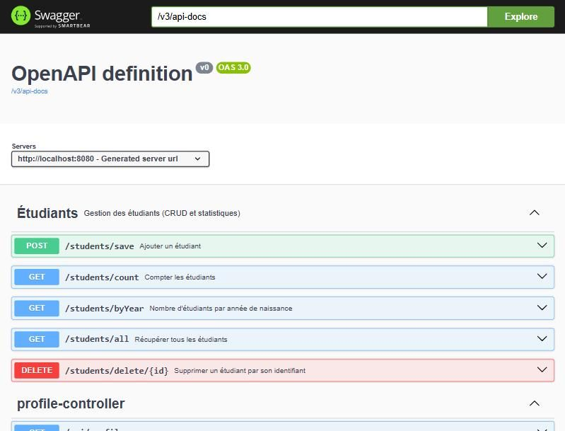
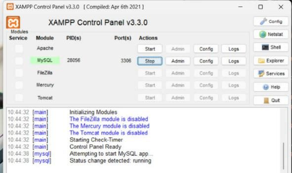
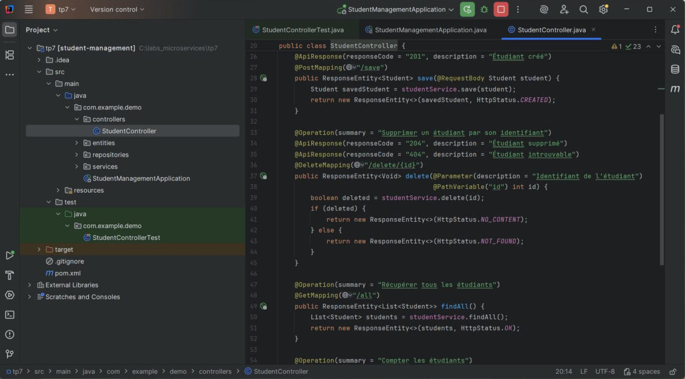
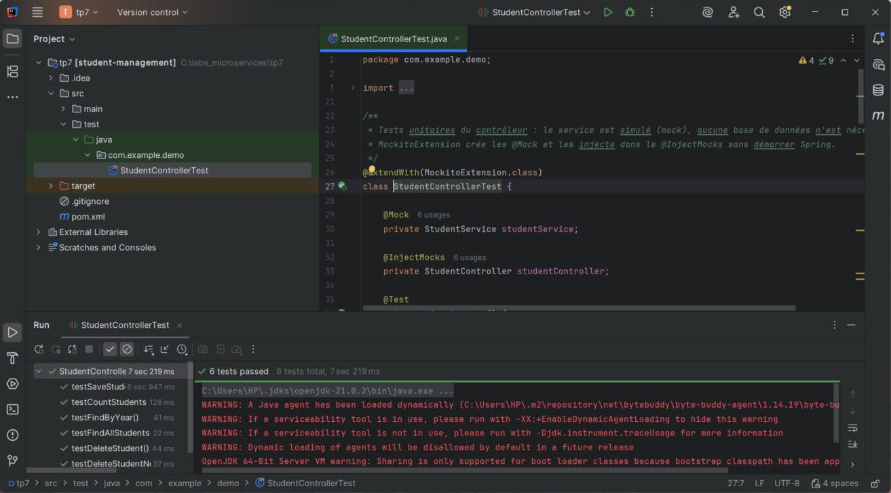
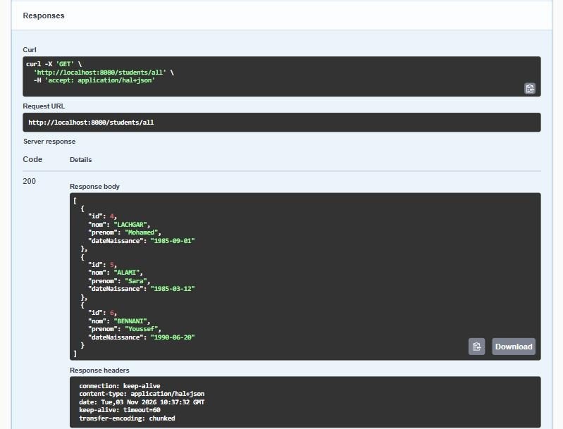

# TP 7 – Spring Boot et Swagger : documentation d'une API REST

> Module : **Architecture Microservices – Conception, Déploiement et Orchestration**
> (lab « TP 6 : Spring Boot et Swagger » sur la plateforme)

Ce TP construit une API REST de **gestion des étudiants** avec **Spring Boot 3** :

- persistance **MySQL** avec **Spring Data JPA** ;
- couches **Repository → Service → Controller** ;
- **tests unitaires** du contrôleur avec **JUnit 5 + Mockito** ;
- **documentation interactive** de l'API avec **Swagger** (springdoc-openapi).

L'application a été **lancée et testée pour de vrai** (MySQL de XAMPP) : les résultats ci-dessous sont des sorties réelles.



---

## Sommaire

1. [Technologies](#technologies)
2. [Architecture](#architecture)
3. [Réalisation pas à pas](#réalisation-pas-à-pas)
4. [Résultats des tests des endpoints](#résultats-des-tests-des-endpoints)
5. [Tests unitaires JUnit 5 + Mockito](#tests-unitaires-junit-5--mockito)
6. [Swagger](#swagger)
7. [Corrections apportées à l'énoncé](#corrections-apportées-à-lénoncé)
8. [Lancer le projet](#lancer-le-projet)
9. [Résumé du TP](#résumé-du-tp)

---

## Technologies

| Outil | Version | Rôle |
|-------|---------|------|
| Java | 17 | Langage |
| Spring Boot | 3.3.5 | Auto-configuration, serveur Tomcat embarqué |
| Spring Web | (Boot) | Contrôleurs REST, JSON |
| Spring Data JPA + Hibernate 6 | (Boot) | Persistance, repositories |
| Spring Data REST | (Boot) | Exposition automatique des repositories (sous `/api`) |
| Validation, DevTools | (Boot) | Validation des entrées, redémarrage automatique |
| MySQL Connector/J | (Boot) | Pilote MySQL (MySQL / MariaDB de XAMPP) |
| springdoc-openapi | 2.6.0 | Swagger UI + description OpenAPI 3 |
| JUnit 5 + Mockito | (Boot) | Tests unitaires |

## Architecture

```
src/main/java/com/example/demo
├── StudentManagementApplication.java   @SpringBootApplication : point d'entrée
├── entities/Student.java               @Entity : table student
├── repositories/StudentRepository.java JpaRepository<Student, Integer> + @Query
├── services/StudentService.java        @Service : logique métier
└── controllers/StudentController.java  @RestController : endpoints /students/...
src/main/resources/application.properties
src/test/java/com/example/demo/StudentControllerTest.java   JUnit 5 + Mockito
```

Le flux d'une requête :

```
Client HTTP (navigateur, Postman, Swagger UI)
   → StudentController (@RestController)   reçoit la requête, renvoie un ResponseEntity
   → StudentService (@Service)              logique métier
   → StudentRepository (JpaRepository)      accès aux données, SQL généré par Hibernate
   → MySQL (base studentdb, table student)
```

---

## Réalisation pas à pas

### 1. Création du projet

Projet Maven : groupe `com.example`, artefact `student-management`, packaging jar. Il utilise les starters Web, Data JPA, Data REST, DevTools, Validation et le pilote MySQL. Le **parent** `spring-boot-starter-parent` fixe des versions cohérentes pour toutes les dépendances.

### 2. Configuration MySQL (`application.properties`)

```properties
spring.datasource.url=jdbc:mysql://localhost:3306/studentdb?createDatabaseIfNotExist=true&serverTimezone=UTC
spring.datasource.username=root
spring.datasource.password=
spring.jpa.show-sql=true
spring.jpa.properties.hibernate.format_sql=true
spring.jpa.hibernate.ddl-auto=update
spring.data.rest.base-path=/api
server.port=8081
```

- Pas besoin de `driver-class-name`, ni de `dialect`, ni de `SessionFactory` : **Spring Boot les déduit tout seul** (auto-configuration).
- `ddl-auto=update` : Hibernate crée la table `student` au démarrage, puis la met à jour.
- MySQL est fourni par **XAMPP** (bouton *Start* sur la ligne MySQL, port 3306).



### 3. Entité `Student`

`@Entity`, `@Id` + `@GeneratedValue(IDENTITY)`, `nom`, `prenom`, et `dateNaissance` en `java.util.Date` avec `@Temporal(TemporalType.DATE)` (on garde seulement la date, sans l'heure). `@JsonFormat(pattern = "yyyy-MM-dd")` contrôle le format JSON.

### 4. Repository

```java
@Repository
public interface StudentRepository extends JpaRepository<Student, Integer> {
    Student findById(int id);
    @Query("SELECT YEAR(s.dateNaissance), COUNT(s) FROM Student s GROUP BY YEAR(s.dateNaissance)")
    Collection<Object[]> findNbrStudentByYear();
}
```

`JpaRepository<Student, Integer>` (entité, type de la clé) fournit `save`, `findAll`, `delete`, `count`, `findById`… **sans écrire d'implémentation** : Spring la génère au démarrage. `@Query` ajoute une requête **JPQL** personnalisée.

### 5. Service et contrôleur REST

`StudentService` (`@Service`) appelle le repository. `StudentController` (`@RestController`, `@RequestMapping("students")`) expose 5 endpoints et renvoie des `ResponseEntity` avec le **bon code HTTP**.

| Méthode | Endpoint | Annotation | Code de succès |
|---------|----------|------------|----------------|
| POST | `/students/save` | `@PostMapping` + `@RequestBody` | 201 Created |
| GET | `/students/all` | `@GetMapping` | 200 OK |
| DELETE | `/students/delete/{id}` | `@DeleteMapping` + `@PathVariable` | 204 No Content (404 si absent) |
| GET | `/students/count` | `@GetMapping` | 200 OK |
| GET | `/students/byYear` | `@GetMapping` | 200 OK |



---

## Résultats des tests des endpoints

Sorties **réelles** obtenues sur l'application lancée :

```
POST   /students/save        -> 201 {"id":4,"nom":"LACHGAR","prenom":"Mohamed","dateNaissance":"1985-09-01"}
POST   /students/save        -> 201 {"id":5,"nom":"ALAMI","prenom":"Sara","dateNaissance":"1985-03-12"}
POST   /students/save        -> 201 {"id":6,"nom":"BENNANI","prenom":"Youssef","dateNaissance":"1990-06-20"}
POST   /students/save        -> 201 {"id":7,"nom":"TAZI","prenom":"Hind","dateNaissance":"1998-11-05"}
GET    /students/all         -> 200 [ ...les 4 étudiants... ]
GET    /students/count       -> 200 4
GET    /students/byYear      -> 200 [[1985,2],[1990,1],[1998,1]]
DELETE /students/delete/7    -> 204
DELETE /students/delete/999  -> 404
GET    /students/count       -> 200 3
```

> Les identifiants commencent à 4 car trois étudiants avaient été créés puis supprimés pendant un premier essai : avec `IDENTITY`, MySQL ne réutilise pas les identifiants.

---

## Tests unitaires JUnit 5 + Mockito

`StudentControllerTest` teste le contrôleur **isolé** : le service est remplacé par un **mock**.

- `@Mock StudentService` crée un faux service.
- `@InjectMocks StudentController` crée le contrôleur et lui injecte le mock.
- `when(...).thenReturn(...)` définit ce que le faux service renvoie.
- `assertEquals` vérifie le **code HTTP** et le **contenu** de la réponse.

Il y a **6 tests** : save → 201, delete → 204, delete d'un id inexistant → 404 (test ajouté), findAll → 2 éléments, count → 10, byYear → liste vide.

**Résultat : 6 tests passed** (en moins de 8 s, sans base de données).



---

## Swagger

Avec la seule dépendance `springdoc-openapi-starter-webmvc-ui`, Spring Boot génère :

- la **description OpenAPI 3** de l'API : `http://localhost:8081/v3/api-docs` ;
- l'**interface Swagger UI** : `http://localhost:8081/swagger-ui.html`.

Les annotations `@Tag`, `@Operation(summary = ...)`, `@ApiResponse` et `@Parameter` enrichissent la documentation. Le bouton **Try it out** permet d'appeler l'API directement depuis le navigateur :



On voit aussi dans Swagger les endpoints générés automatiquement par **Spring Data REST** sous `/api/students` (CRUD complet au format HAL), sans aucun code.

---

## Corrections apportées à l'énoncé

| Problème | Correction |
|----------|-----------|
| `springdoc-openapi` **2.0.2** n'est pas compatible avec Spring Boot 3.3 | Version **2.6.0** |
| Avec Spring Data REST, le repository est exposé sur `/students/{id}` et entre en conflit avec `/students/all`, `/students/count`… | `spring.data.rest.base-path=/api` |
| `@SpringBootTest` + `@Mock` démarre tout Spring, donc il faut MySQL, alors que les mocks ne sont même pas utilisés par le contexte | `@ExtendWith(MockitoExtension.class)` : vrai test unitaire, rapide, sans base |
| Dates renvoyées **un jour plus tôt** (1985-09-01 → 1985-08-31) : `java.util.Date` + fuseau du PC (Maroc, UTC+1) différent de celui de JSON / MySQL (UTC) | `TimeZone.setDefault(UTC)` au démarrage de l'application |
| Le port **8080** est déjà occupé par **Apache (XAMPP)** sur ce PC : « Port 8080 was already in use » | `server.port=8081` |
| Les packages de l'énoncé ne sont pas cohérents (`com.example.studentmanagement.*` / `com.example.demo.*`) | Tout est dans `com.example.demo` |

## Lancer le projet

1. Démarrer **MySQL** (XAMPP → *Start* sur MySQL).
2. Ouvrir le dossier dans IntelliJ, attendre le téléchargement Maven.
3. Lancer `StudentManagementApplication` et attendre `Started StudentManagementApplication in … seconds`.
4. Ouvrir `http://localhost:8081/swagger-ui.html`.
5. Tests : clic droit sur `StudentControllerTest`, puis **Run**, ou `mvn test`.

---

## Résumé du TP

- **Spring Boot** simplifie tout : le parent et les starters gèrent les dépendances, l'auto-configuration crée la DataSource et la persistance, et Tomcat est embarqué. On démarre avec une simple méthode `main`.
- **Spring Data JPA** : en étendant `JpaRepository<Student, Integer>`, on obtient tout le CRUD sans implémentation. `@Query` sert aux requêtes JPQL personnalisées.
- **REST** : `@RestController`, les mappings HTTP (`@GetMapping`, `@PostMapping`, `@DeleteMapping`), `@RequestBody`, `@PathVariable`, et `ResponseEntity` avec des codes HTTP précis (201, 200, 204, 404).
- **Tests** : JUnit 5 + Mockito testent le contrôleur isolé du service et de la base.
- **Swagger / OpenAPI** : documentation générée automatiquement, toujours à jour, et testable depuis le navigateur.
